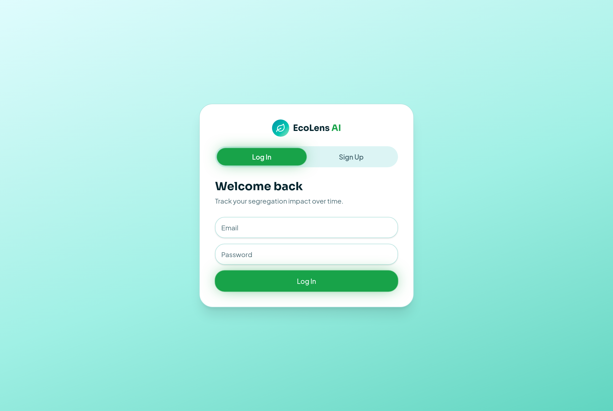
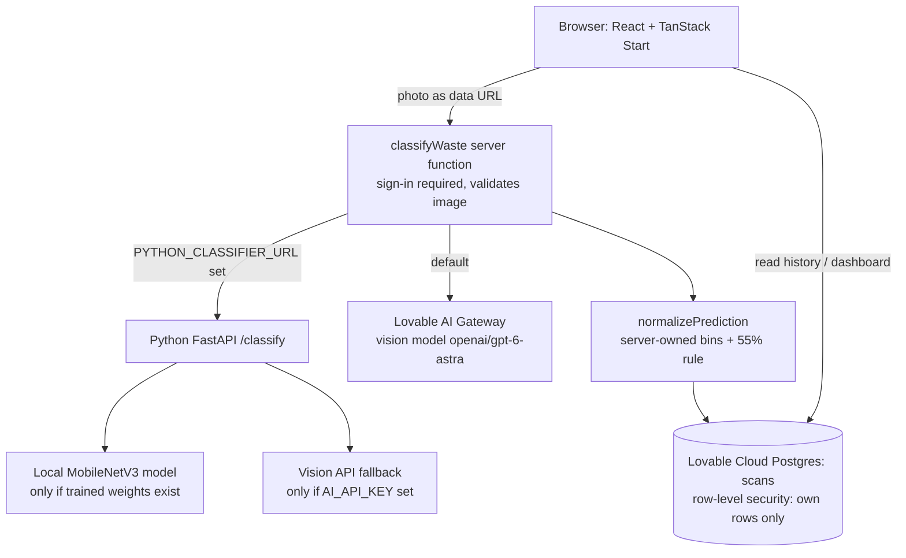
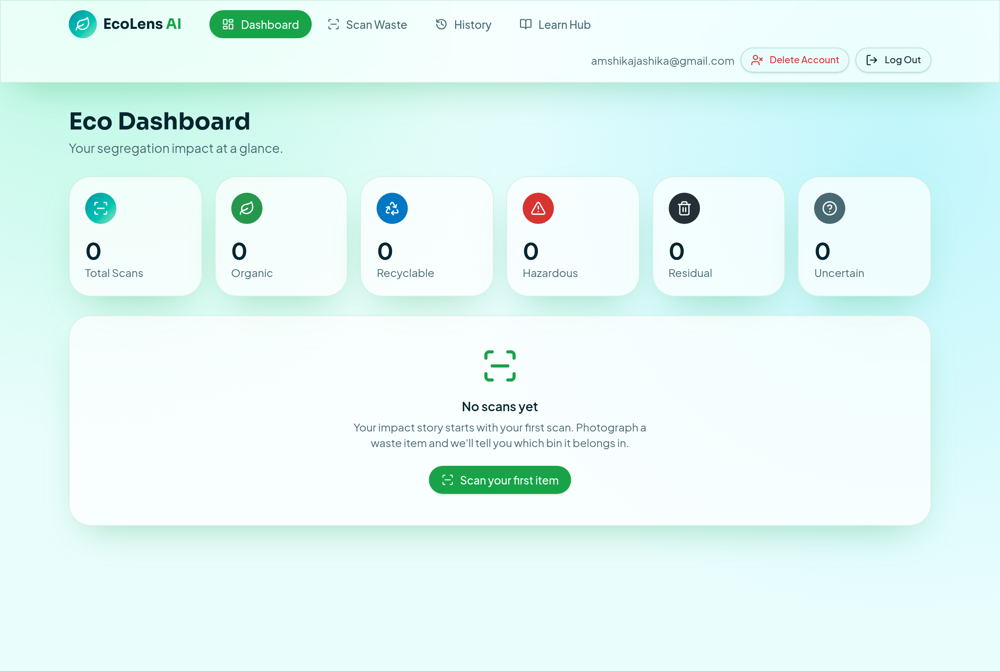
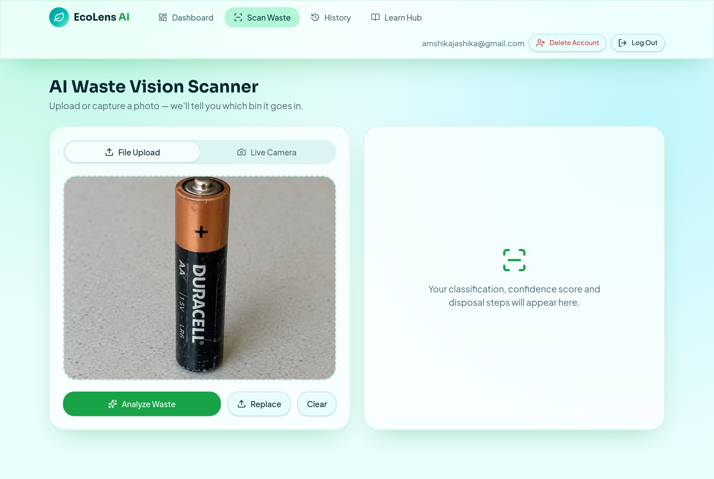
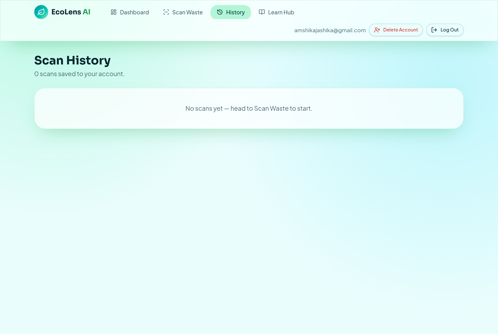
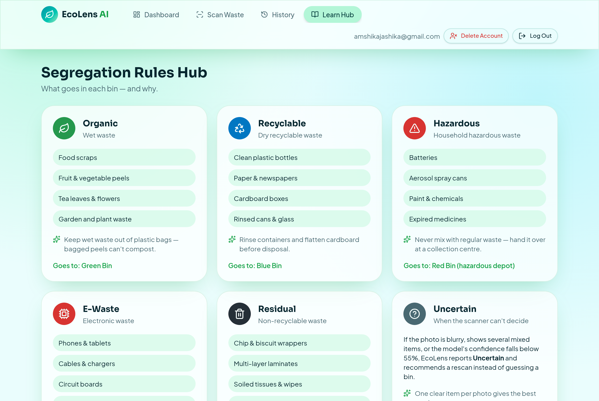
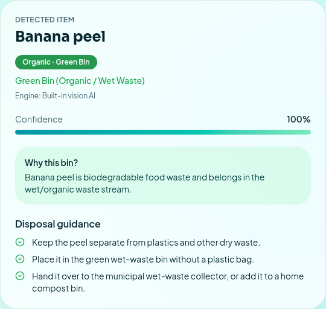
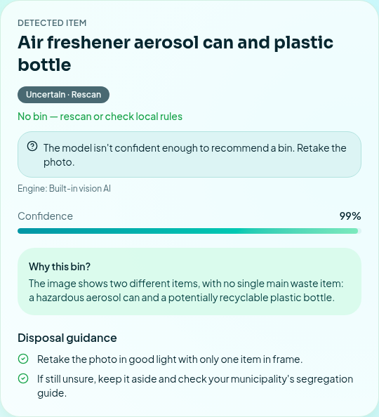

# ECO-LENSAI — AI-Powered Smart Waste Segregation System

**Scan. Sort. Save.**

**Neural Storm 2026 · Track: Green Planet · Problem Statement GP-05: Smart Waste Segregation System**

| | |
|---|---|
| Team name | solo stack |
| Team leader | Jashika Rajasekaran |
| Institution | Rathinam Technical Campus |
| GitHub | <https://github.com/jashikaraja05-pixel/ECO-LENSAI> |
| Live demo | _Not published yet — add the URL here once the app is published and checked._ |
| Demo video | **[ADD VIDEO LINK HERE]** |



## 1. Problem statement

Incorrect waste segregation causes environmental pollution and reduces recycling efficiency. Mixed household waste spoils recycling streams and sends hazardous items such as batteries and e-waste to landfill. Most people don't know which bin an item belongs in, and printed segregation guides are easy to forget.

## 2. Proposed solution

ECO-LENSAI lets anyone photograph a waste item (upload or live camera). AI-assisted image classification assigns it to one of five categories, the app recommends the correct bin, and it shows disposal and safety steps. When the classifier is not confident, the app shows **Uncertain** and asks for a rescan instead of guessing. Every scan is saved to the user's private history and feeds a personal dashboard.

## 3. Objectives

- Make correct segregation a 10-second task for households.
- Never present a guess as a fact: low-confidence results are reported as Uncertain.
- Keep each user's data private.
- Provide a path to a self-hosted, trained model (Python service) without changing the app.

## 4. Key features

- Email/password accounts with email confirmation
- Image upload and live camera capture. The browser accepts JPG/PNG/WebP up to 15 MB and resizes the photo; the server checks type, size and file signature (magic bytes)
- Classification result: category, bin, confidence, explanation, disposal steps, safety notes, reuse tips
- Uncertain state for confidence below **55 %**, blurry photos or several mixed items
- Clear error state with **Try again**; nothing is saved when classification fails
- Private scan history: search, filter, view details, delete one scan, clear all, delete account
- Dashboard computed from saved scans only: totals, per-category counts and chart, active days, average confidence, pilot accuracy (from scans the user marked as checked)
- Learn Hub: five category cards, the Uncertain rule, quick guides (segregation basics, recycling, composting, battery/e-waste safety, plastic reduction, why it matters), and a plain statement of what the scanner can recognise
- Optional Python FastAPI + PyTorch service (`backend/`)

## 5. System architecture



**What runs today:** the deployed app classifies through the **Lovable AI Gateway** (a general vision model). The Python service is optional and **not deployed**; its local model is **not trained yet**. If the Python service is configured but unreachable, the scan fails visibly. The app never falls back to another engine without telling you.

## 6. Technology stack

- **Frontend:** React 19, TanStack Start (SSR + server functions), Tailwind CSS v4, shadcn/ui, lucide-react
- **Backend:** Lovable Cloud (Postgres with row-level security, auth, server functions)
- **AI:** Lovable AI Gateway vision model (`openai/gpt-6-astra`) via the AI SDK
- **Optional service:** Python 3.11+, FastAPI, uvicorn, PyTorch + torchvision (MobileNetV3-Small), scikit-learn
- **Testing:** Vitest (unit), pytest (Python), Playwright (end-to-end)

## 7. AI classification workflow

1. The browser resizes the photo to ≤ 768 px and sends it to the `classifyWaste` server function (sign-in required).
2. The server validates the image (JPEG/PNG/WebP, size limit, file signature check).
3. The selected engine returns `item, category, confidence, reasoning, steps`.
4. `normalizePrediction` (`src/lib/scan-schema.ts`) validates the output, applies the **55 % uncertainty rule**, and sets the bin from a fixed server-side mapping (the model's own bin text is never used).
5. The result is saved to the user's `scans` row and shown in the UI.

Confidence from the built-in vision AI is **self-reported by the model**, so the app labels it "AI-estimated confidence". It is not measured accuracy.

## 8. Categories and actual coverage

| Category | Bin | Built-in vision AI (active) | Local model — TrashNet (default, not trained) | Local model — 12-class set (optional) |
|---|---|---|---|---|
| Organic | Green | Yes | **No** | Yes (biological) |
| Recyclable | Blue | Yes | Yes (cardboard, glass, metal, paper, plastic) | Yes |
| Hazardous | Red (depot) | Yes (general model) | **No** | **Batteries only** |
| E-waste | Red (e-waste) | Yes | **No** | Yes (with GIZ e-waste images) |
| Residual | Black | Yes | Yes (trash) | Yes |
| Uncertain | — rescan | < 55 % or flagged | < 55 % | < 55 % |

The local model does **not** detect chemicals, medicines or aerosols as hazardous. With TrashNet alone it can only predict recyclable and residual.

## 9. Dataset information and attribution

- **TrashNet** — Gary Thung & Mindy Yang, MIT License — <https://github.com/garythung/trashnet> (6 classes: cardboard, glass, metal, paper, plastic, trash). This is the default for `prepare_dataset.py`.
- Optional 12-class garbage dataset and **GIZ E-Waste Database** (CC BY 4.0) — see `backend/README.md` for the class-to-category mapping and licences.
- No datasets are committed to this repository (`backend/data/` is git-ignored).

## 10. Installation

```bash
git clone https://github.com/jashikaraja05-pixel/ECO-LENSAI.git
cd ECO-LENSAI
```

### Frontend setup
```bash
cp .env.example .env   # fill in your values
bun install
bun run dev            # http://localhost:8080
```

### Backend setup (optional Python service)
```bash
cd backend
python3 -m venv .venv && source .venv/bin/activate
pip install -r requirements.txt
cp .env.example .env   # set CLASSIFIER_API_KEY, etc.

python prepare_dataset.py --source hf --data-dir data   # download + leakage-free split
python train.py --split data/split.json --epochs 25     # needs a torch environment (GPU recommended)
python evaluate.py --split data/split.json              # held-out test metrics only

uvicorn main:app --port 8000                            # GET /health shows the active engine
```

## 11. Environment variables

| Name | Where | Purpose |
|---|---|---|
| `VITE_SUPABASE_URL`, `VITE_SUPABASE_PUBLISHABLE_KEY`, `VITE_SUPABASE_PROJECT_ID` | web app (public) | Database/auth connection — public values, filled in by Lovable |
| `LOVABLE_API_KEY` | app server (managed) | Built-in AI classification |
| `PYTHON_CLASSIFIER_URL` | app server (optional) | Route scans to the Python service |
| `PYTHON_CLASSIFIER_API_KEY` | app server (optional) | Sent as `X-Classifier-Key` to the Python service |
| `CLASSIFIER_API_KEY` | Python service | Required shared key for `/classify` |
| `ALLOW_UNAUTHENTICATED` | Python service | `1` = skip the key check (local development only) |
| `AI_API_KEY`, `AI_BASE_URL`, `AI_MODEL` | Python service (optional) | Vision-API fallback when no trained model exists |
| `ML_MODEL_DIR` | Python service (optional) | Folder with `best.pt` + `config.json` |
| `CORS_ORIGINS` | Python service (optional) | Comma-separated browser origins; not needed for server-to-server calls |

No secret keys are in the code. `.env.example` (root) and `backend/.env.example` contain placeholders only. The root `.env` contains only the public connection values.

## 12. API endpoints (Python service)

`GET /health` → `{"status":"ok","engine":"local-ml:<dataset>" | "gateway-fallback" | "none","local_model":bool,...}`

`POST /classify` (multipart field `file`, JPEG/PNG/WebP ≤ 6 MB, header `X-Classifier-Key`) →
```json
{"item":"plastic","category":"recyclable","confidence":87,"reasoning":"...","steps":["..."],"bin":"Blue Bin (Dry Recyclable Waste)","warnings":[]}
```
Errors: `401` bad key, `413` too large, `415` not an image, `422` missing file / too small, `503` no engine available, `502` model error, `402/429` usage limits.

## 13. Testing

```bash
bunx vitest run                       # web unit tests
cd backend && python -m pytest -q     # Python tests (torch tests skip if torch is absent)
```

Results from the 4 Nov 2026 run:
- **Web unit tests:** 16 / 16 passed. They cover the bin mapping, the 55 % threshold, rejection of bad model output, bad uploads and oversized images, dashboard statistics, pilot accuracy and safety warnings.
- **Python tests:** 16 passed, 3 skipped. The 3 skipped tests need torch, which wasn't installed in the test environment.
- **End-to-end test** (real browser, built-in AI): signed in, uploaded a plastic-bottle photo, got **Recyclable → Blue Bin**, and the scan was saved. A second account could not read or change it.

**Not tested:** a classification through a *deployed* Python service, a trained local model (no weights exist), a real email-confirmation link, and a physical phone camera.

## 14. Deployment

- **Web app:** publish from Lovable. The frontend, auth, database and classification all run there, so no separate hosting is needed. After publishing, add the live URL at the top of this README.
- **Python service (optional):** deploy `backend/` to a Python host (Render, Railway, Fly.io, or use the `Dockerfile`) with `uvicorn main:app --host 0.0.0.0 --port $PORT`. Set `CLASSIFIER_API_KEY`. Include a trained `models/` folder to use the local model. Then add the app secrets `PYTHON_CLASSIFIER_URL` and `PYTHON_CLASSIFIER_API_KEY`. Until then, the app uses the built-in vision AI.

## 15. Limitations and future improvements

- The active classifier is a general third-party vision model. Its confidence is self-reported, not calibrated accuracy.
- The local PyTorch model is implemented but **not trained**, so no accuracy metrics are claimed.
- One main item per photo works best. Mixed photos are *asked* to return Uncertain, but that isn't guaranteed.
- Bin colours follow common Indian municipal rules, and local rules vary.
- Images are stored compressed (≤ 768 px) in the database.
- Future work: train and evaluate the local model, add hazardous classes beyond batteries, offer multilingual guidance, and find nearby drop-off points.

## For judges: test account

- Email: **[ADD JUDGE TEST EMAIL]**
- Password: **[ADD JUDGE TEST PASSWORD]**

Or sign up with your own email and click the confirmation link. Each account sees only its own scans.

## Screenshots

| | |
|---|---|
|  |  |
|  |  |
|  |  |

## AI tools disclosure

- Built with the Lovable AI coding assistant (and ChatGPT for review).
- Test images used in end-to-end checks were AI-generated.

## License

Released under the [MIT License](LICENSE).
